# Diagramas

Diagramas en [Mermaid](https://mermaid.js.org/); GitHub los dibuja solo. Cada
cambio en la app actualiza aquí el diagrama afectado o agrega uno nuevo.

- [Arquitectura general](#arquitectura-general)
- [Ciclo de un tiro](#ciclo-de-un-tiro)
- [Estados de la sala](#estados-de-la-sala)
- [Modelo de datos](#modelo-de-datos)
- [Inicio de sesión y permisos](#inicio-de-sesión-y-permisos)
- [Integración y despliegue](#integración-y-despliegue)
- [Versiones y releases](#versiones-y-releases)
- [Idiomas](#idiomas)
- [Inicio desde la plantilla](#inicio-desde-la-plantilla)

## Arquitectura general

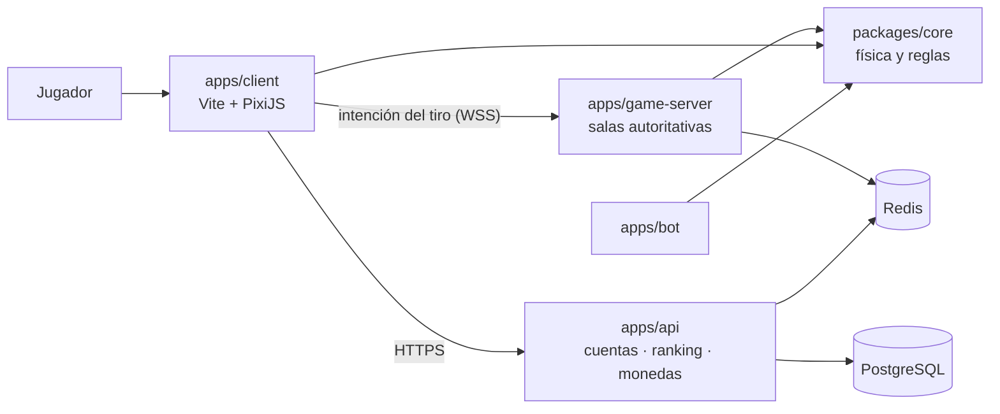

El cliente usa `core` solo para animar; el servidor de partidas lo usa para
decidir el resultado.

## Ciclo de un tiro

```mermaid
sequenceDiagram
  actor A as Jugador en turno
  participant CA as Cliente A
  participant S as Servidor de partidas
  participant CB as Cliente B
  A->>CA: apunta y suelta
  CA->>S: tirar(ángulo, fuerza, efecto, secuencia)
  S->>S: valida turno, rangos, secuencia y reloj
  alt inválido
    S-->>CA: rechazo (queda como señal de la cuenta)
  else válido
    S->>S: simula con packages/core y aplica reglas
    S->>S: guarda la entrada en la repetición
    S-->>CA: resultado + hash
    S-->>CB: resultado + hash
    CA->>CA: anima; si el hash no coincide, toma la posición del servidor
    CB->>CB: anima; si el hash no coincide, toma la posición del servidor
  end
```

## Estados de la sala

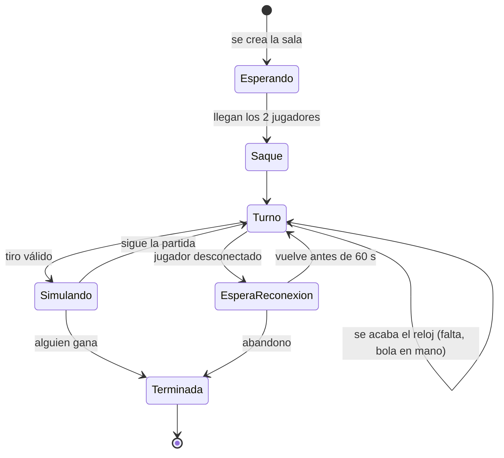

## Modelo de datos

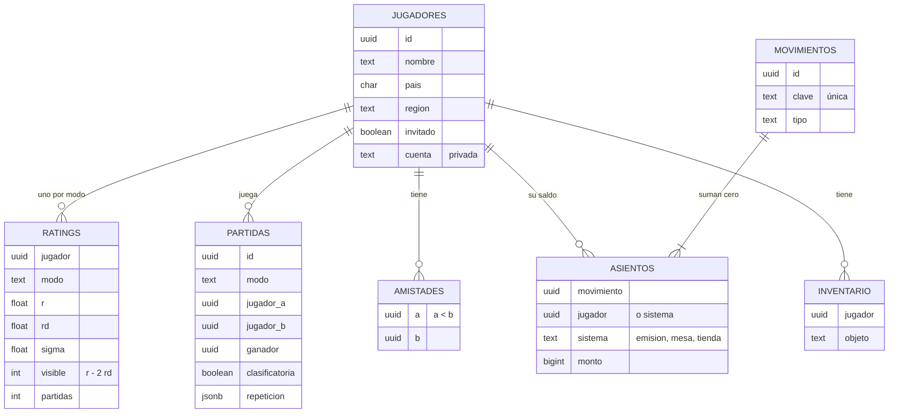

Migraciones en `apps/api/migraciones/`. Seguridad por fila: con el rol
`tacazo_api` cada jugador ve solo sus partidas y amistades, y edita solo su
perfil; `tacazo_partidas` (el servidor de partidas) guarda partidas y ratings, y
`tacazo_monedas` es el único que escribe en el libro de monedas.
Detalle en [ADR 0004](adr/0004-postgres-migraciones-rls.md).

## Monedas en una clasificatoria

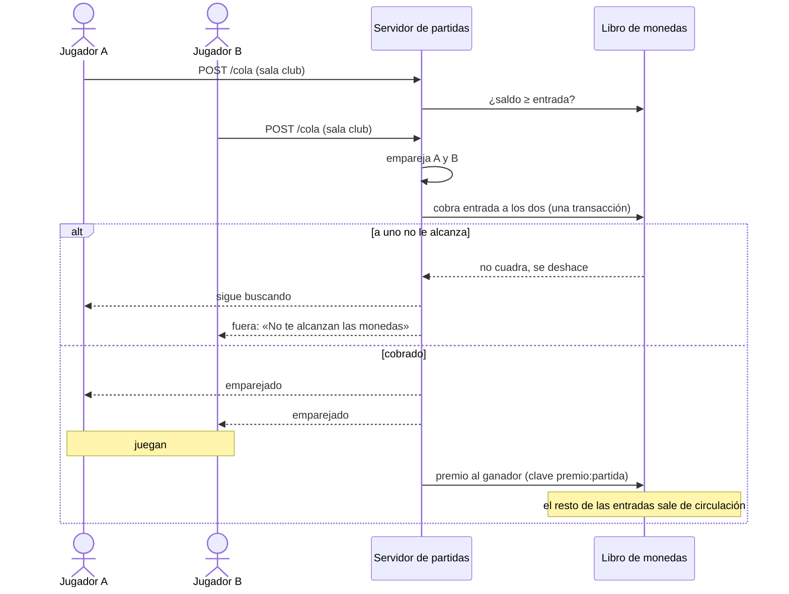

## Anuncios

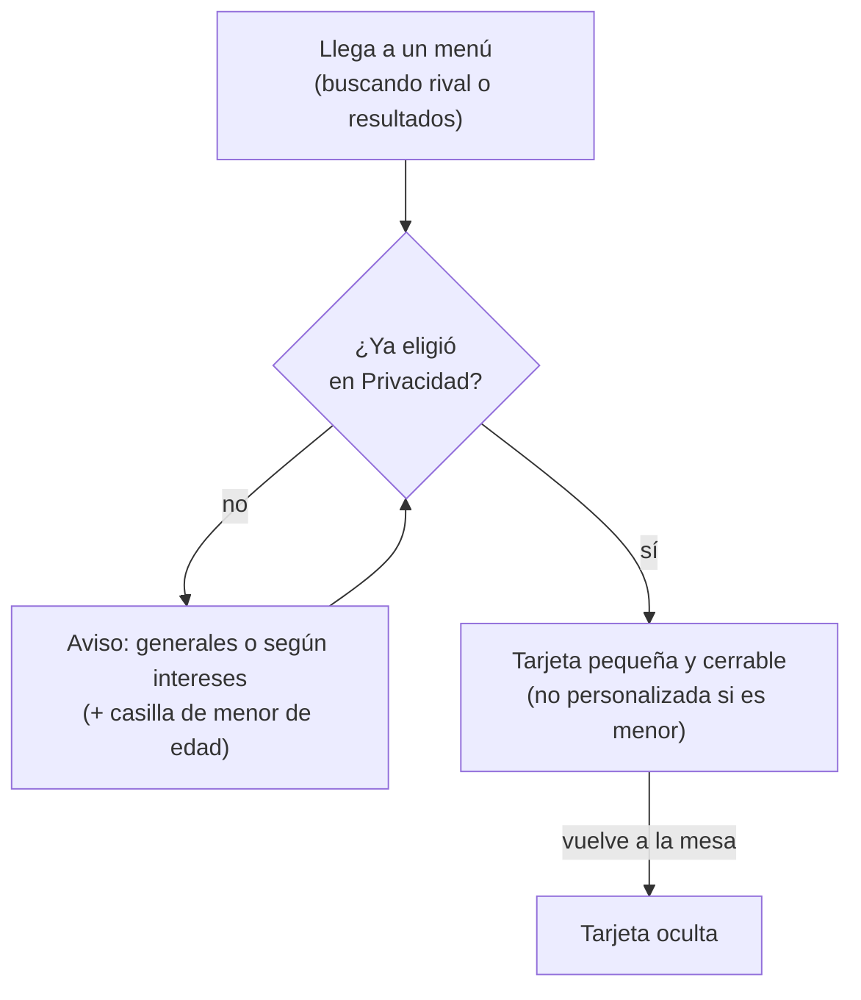

El anuncio con premio y su verificación en el servidor están en
[ECONOMIA.md](ECONOMIA.md#cómo-está-hecho).

## Moderación

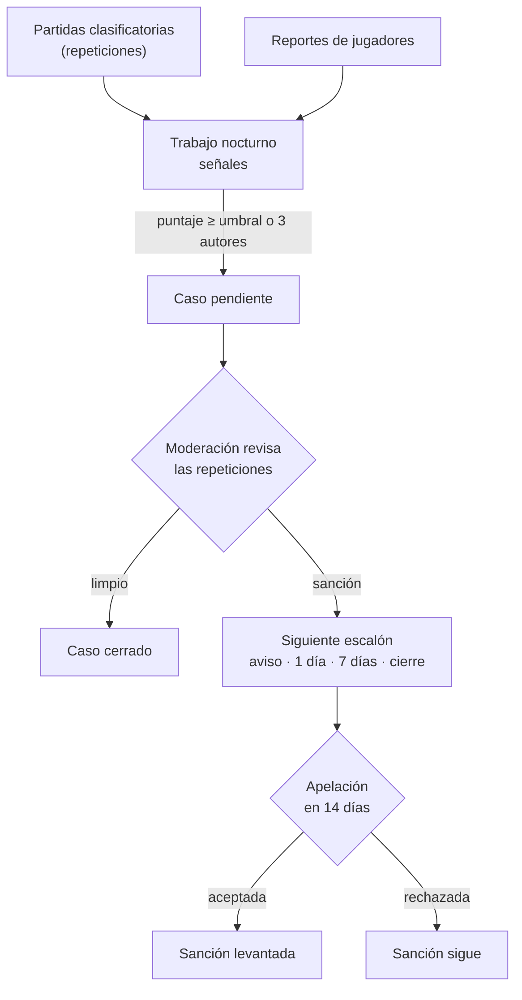

## Inicio de sesión y permisos

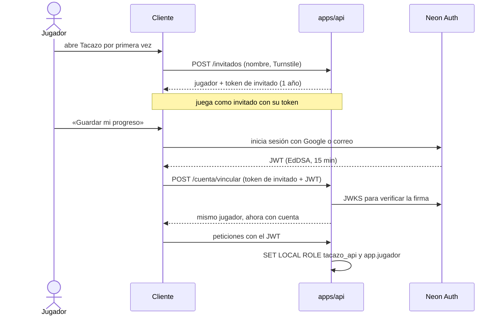

La base decide qué ve cada jugador con seguridad por fila
([ADR 0004](adr/0004-postgres-migraciones-rls.md)); las cuentas, en
[ADR 0005](adr/0005-neon-auth.md).

## Integración y despliegue

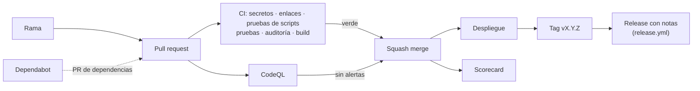

## Versiones y releases

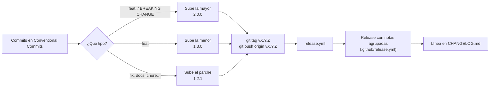

## Idiomas

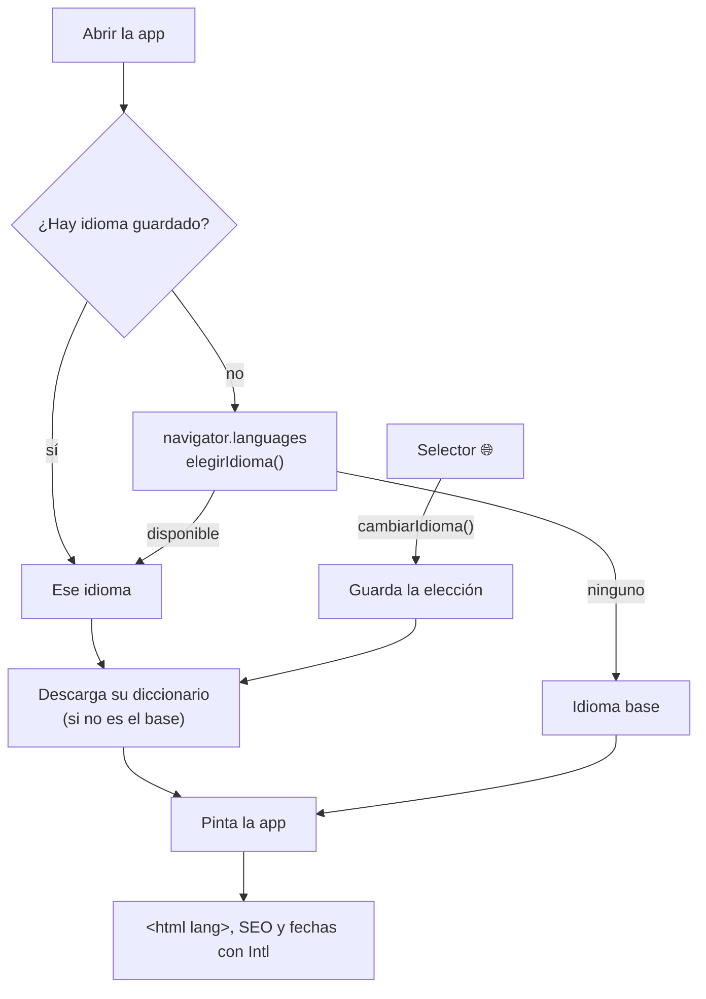

## Inicio desde la plantilla

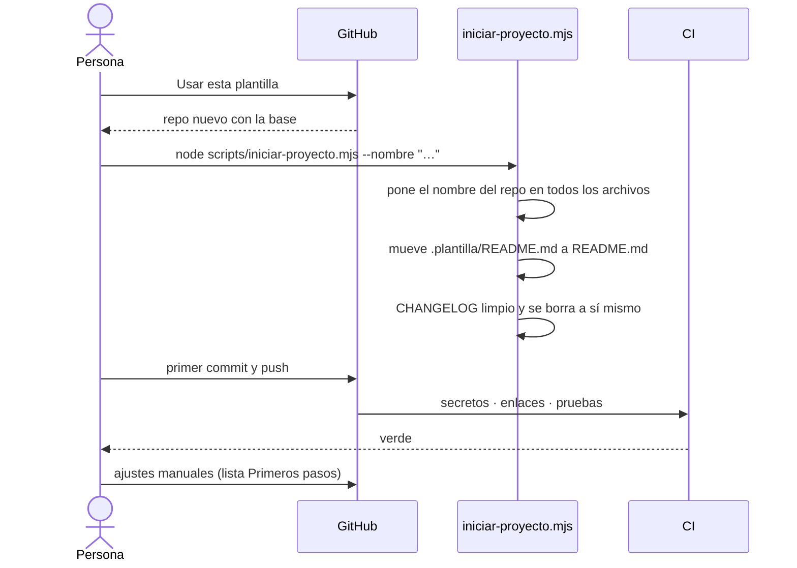
