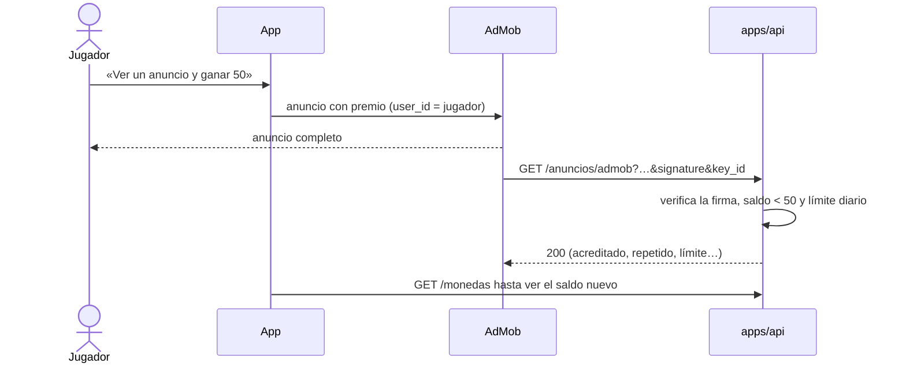

# Economía

Tacazo es **gratis**. Todo se gana jugando; las monedas son virtuales y nunca se
cambian por dinero. El juego se sostiene con anuncios muy discretos. La tienda
con dinero real queda para la fase 10.

## Reglas

| Punto | Cómo |
| --- | --- |
| Libro contable | Cada movimiento es una fila de doble entrada; el saldo se calcula, no se edita |
| Solo el servidor mueve monedas | El cliente pide acciones ("entrar a sala 3"), nunca envía montos |
| Idempotencia | Cada cobro y premio con una clave única |
| Salas por nivel | Entrada fija; premio menor que el doble para frenar la inflación |
| Nadie se queda sin jugar | Premio diario; práctica y partidas con amigos no cuestan |
| Sin transferencias | No se regalan monedas entre cuentas |
| Sin cajas sorpresa | No se usan |

## Montos

| Fuente o sumidero | Monedas | Cuándo |
| --- | --- | --- |
| Bienvenida | +500 | Una vez, al crear el jugador |
| Premio del día | +100 | Una vez por día de Colombia (cambia a medianoche UTC−5) |
| Entrada a sala | −50 · −200 · −1.000 | Al encontrar rival, a los dos a la vez |
| Premio de sala | +90 · +360 · +1.800 | Al ganador; el resto de las dos entradas sale de circulación |
| Devolución | + la entrada | Si la partida termina sin ganador o alguien cancela mientras se cobra |
| Cosméticos | −600 a −5.000 | Compra única; no dan ventaja en la mesa |

| Sala | Entrada | Premio | Sumidero por partida |
| --- | --- | --- | --- |
| Billar de barrio | 50 | 90 | 10 |
| Club | 200 | 360 | 40 |
| Campeonato | 1.000 | 1.800 | 200 |

Los montos viven en `apps/api/src/monedas.ts`. Si el panel muestra que la masa
crece mucho, se ajustan ahí (por ejemplo, bajar el premio diario o subir el
sumidero de las salas altas).

## Cosméticos

| Objeto | Cómo se consigue |
| --- | --- |
| Taco de roble, paño verde, marco de madera | Gratis desde el inicio |
| Taco con virola de latón | 600 monedas |
| Paño azul petróleo, paño vino | 800 monedas |
| Taco de ébano | 2.500 monedas |
| Marco de oro | 5.000 monedas |
| Marco de bronce | 10 clasificatorias jugadas |
| Paño de torneo | 50 clasificatorias jugadas |
| Taco del veterano | 100 clasificatorias jugadas |

El catálogo está en el código; la base solo guarda qué tiene cada jugador
(`inventario`) y qué lleva puesto (`jugadores.equipado`).

## Cómo funciona el libro

- `movimientos` tiene una fila por operación con su **clave única**
  (`entrada:<partida>:<jugador>`, `premio:<partida>`, `diario:<jugador>:<día>`…).
  Repetir la petición choca con la clave y no hace nada.
- `asientos` tiene las líneas: cada una toca a un jugador o a una cuenta del
  sistema (`emision`, `mesa`, `tienda`). Las de un movimiento suman cero.
- Al cerrar la transacción, un disparador diferido revisa que cada movimiento
  cuadre y que ningún jugador quede en negativo; si no, se deshace todo.
- Nadie puede editar ni borrar asientos, ni siquiera el dueño de las tablas.
  Un error se corrige con otro movimiento de tipo `ajuste`.
- Para cobrar, el servidor bloquea las filas de los jugadores en orden
  (`FOR UPDATE`): dos cobros a la vez al mismo jugador van uno detrás del otro.
- Solo el rol `tacazo_monedas` escribe en el libro. Cada jugador lee solo sus
  asientos y su saldo (seguridad por fila).

## Panel de fuentes y sumideros

```bash
DATABASE_URL=... pnpm --filter @tacazo/api monedas 30
```

Muestra por tipo cuánto entró y salió en los últimos N días, el neto y las
monedas en circulación. Un neto positivo sostenido es inflación.

## Límites conocidos

- Si el servidor de partidas se reinicia en plena partida, las entradas
  cobradas quedan en la cuenta `mesa` sin premio ni devolución. Falta un
  trabajo que las devuelva (partidas con entrada y sin premio ni devolución
  después de unas horas).

## Anuncios

| Punto | Cómo |
| --- | --- |
| Dónde | Solo en menús: una tarjeta pequeña en la sala de espera o en resultados, sin sonido y cerrable |
| Dónde no | Nunca en la mesa, entre tiros ni a pantalla completa sin pedirlo |
| Anuncio con premio | Si el saldo no alcanza para la sala más barata, la persona puede elegir ver un anuncio y recibir monedas, con límite diario |
| Premio verificado | Las monedas se acreditan solo cuando la red de anuncios confirma al servidor que se vio completo |
| Privacidad | Consentimiento antes de cargar anuncios; permiso de rastreo en iOS; a menores solo anuncios no personalizados |
| Redes | AdSense en la web (tarjeta en menús); AdMob en las apps (tarjeta y anuncio con premio) |

### Cómo está hecho

- **Consentimiento** (`apps/client/src/anuncios.ts` y `politica-anuncios.ts`).
  No se carga ningún script de anuncios hasta que la persona elige entre
  «Anuncios generales» y «Según mis intereses». Se pregunta la primera vez
  que llega a un menú, no al abrir el juego, y se cambia en **Privacidad**.
  Quien marca «Tengo menos de 18 años» recibe siempre anuncios no
  personalizados (`requestNonPersonalizedAds`). La elección lleva versión: si
  cambia el texto, se vuelve a preguntar.
- **Tarjeta**: `#anuncio`, de 60 a 100 px de alto, con la etiqueta
  «Publicidad» y una ×. Se ve solo mientras se busca rival y con la partida
  terminada. Al volver a la mesa se oculta. Sin las metas `tacazo-adsense` y
  `tacazo-adsense-slot` no aparece nada, ni el botón Privacidad.
- **Anuncio con premio** (`apps/api/src/anuncios.ts`): +50 monedas, máximo 3
  por día de Colombia, y solo si el saldo no alcanza para la entrada más
  barata (50). AdMob llama a `GET /anuncios/admob` firmado con ECDSA; el
  servidor verifica la firma con las claves públicas de Google (guardadas
  24 h) y acredita con la clave `anuncio:<transaction_id>`, así un reintento
  de AdMob no paga dos veces. El `user_id` del anuncio es el id del jugador.
- **En la web no hay anuncio con premio**: AdSense no avisa al servidor que el
  anuncio se vio, así que no se puede verificar. El botón aparece solo dentro
  de la app (puente `window.TacazoNativo.anuncioConPremio`, que llega con las
  apps en la fase 6), junto con el permiso de rastreo de iOS.



## Tienda (fase 10, más adelante)

Tacos, monedas, pase de temporada, cosméticos y quitar anuncios. Recibos
validados en el servidor, precio total visible antes de pagar y nada que dé
ventaja en la mesa.
