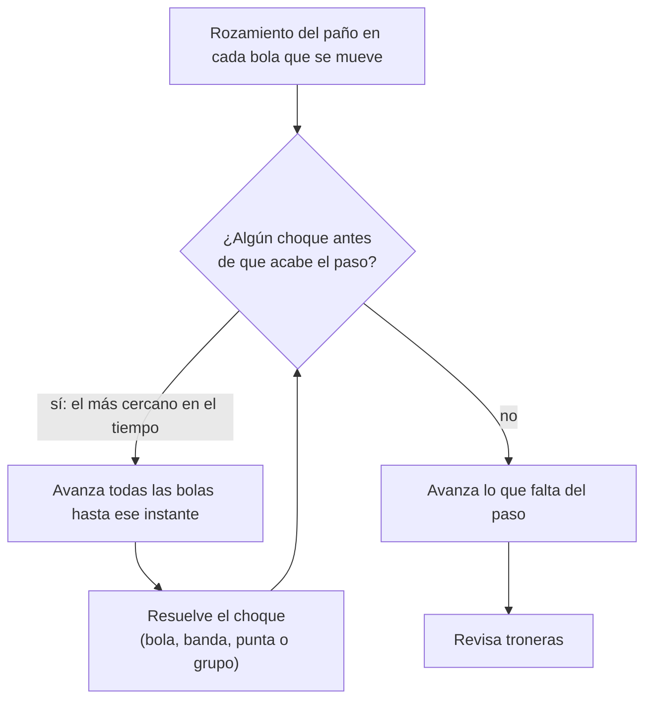

# Física

El motor vive en `packages/core` y es **determinista**: la misma entrada da el
mismo resultado en cualquier máquina. Por eso el servidor puede decidir cada
tiro y las repeticiones se pueden volver a simular.

## Reglas del motor

- Paso fijo de 1/480 s (`STEP`), desacoplado del dibujo; el cliente interpola.
- Sin `Math.random`, reloj ni APIs del navegador: lo impide el lint.
  La aleatoriedad sale de `createRng(semilla)` con la semilla del servidor.
- Sin `Math.sin`, `Math.cos`, `Math.hypot`, `Math.log` ni `Math.pow`: no dan el
  mismo último bit en V8 (servidor) y JavaScriptCore (iPhone). El motor usa
  `dsin`, `dcos` y `dln` de `dmath.ts`, hechos solo con + − × ÷ y `Math.sqrt`.
  También lo impide el lint.
- Cada cambio de física sube `ENGINE_VERSION`; el servidor rechaza clientes con
  otra versión y los tiros dorados obligan a regenerarlos.

## Modelo

Cada bola tiene posición, velocidad `(vx, vy)` y giro `(wx, wy, wz)`. Todas
pesan lo mismo (masa 1) y su momento de inercia es 2/5·R².

| Fase | Qué pasa | Dónde |
| --- | --- | --- |
| Golpe del taco | El punto de contacto (efecto lateral y vertical hasta media bola) y la inclinación dan velocidad y giro. El efecto lateral desvía un poco la blanca al lado contrario | `strike()` |
| Deslizamiento | Mientras el punto de apoyo resbala, el paño frena con μ = 0,2 y va pasando velocidad a giro hasta que la bola rueda | `applyCloth()` |
| Rodadura | Frena con μ = 0,01; el giro sigue a la velocidad | `applyCloth()` |
| Efecto lateral | `wz` se frena a 10 rad/s² | `applyCloth()` |
| Curva (massé) | Con el taco inclinado y efecto lateral, parte del giro queda sobre el eje de avance y el paño curva la trayectoria | sale sola del deslizamiento |
| Choque bola-bola | Restitución 0,95 y rozamiento 0,06 entre bolas (el efecto lateral "empuja" la bola golpeada) | `collideBalls()` |
| Grupo de bolas que se tocan | En el triángulo los contactos se solapan en el tiempo. Se simulan con resortes amortiguados en micro pasos (contacto de 0,2 ms) para que el saque abra la mesa como en la realidad | `collideCluster()` |
| Banda | Restitución 0,75 y rozamiento 0,2: el efecto lateral cambia el ángulo de salida. La banda se come el giro de rodadura hacia ella | `collideWall()` |
| Tronera | Cae si el centro entra en el círculo de la tronera o cruza el borde del área de juego por la boca | `checkPockets()` |

Las constantes viven en `ClothSpec` de cada mesa, así carambola y snooker
pueden tener su propio paño sin tocar el motor.

## Un paso

La búsqueda de choques es continua: se calcula el instante exacto en que dos
bolas, o una bola y una goma, se tocan. Ninguna bola atraviesa nada aunque vaya
rápido.

## Tiros dorados

`packages/core/test/tiros-dorados.json` guarda 50 tiros (10 saques y 40 tiros
al azar con semilla fija) con su huella exacta (`worldHash`, FNV-1a sobre los
bits de cada posición). CI falla si cambia un solo bit.

Si el cambio de física es intencional: sube `ENGINE_VERSION`, corre
`UPDATE_GOLDEN=1 pnpm test:golden` y explica el diff en el PR.

## Mesas como datos

| Mesa | Área de juego | Bola | Troneras | Estado |
| --- | --- | --- | --- | --- |
| `pool-9ft` | 2,54 × 1,27 m | 57,2 mm | 6 | ✅ `POOL_9FT` |
| Carambola | 2,84 × 1,42 m | 61,5 mm | 0 | Fase 8 |
| Snooker | 3,57 × 1,78 m | 52,5 mm | 6 estrechas | Fase 8, con `pocketTable()` |

Una mesa trae medidas, troneras, gomas (segmentos), línea de cabecera, punto de
pie y paño. `validateTable()` la revisa antes de usarla.

## Pruebas

| Qué | Archivo |
| --- | --- |
| Seno, coseno y logaritmo deterministas contra `Math` | `physics.test.ts` |
| Seguimiento, retroceso y tiro seco; efecto en banda; curva; desvío | `physics.test.ts` |
| Una bola directa entra en la tronera que se apunta | `physics.test.ts` |
| El saque abre el triángulo | `physics.test.ts` |
| La energía nunca aumenta; ninguna bola acaba fuera ni encima de otra | `physics.test.ts` |
| El mismo tiro da el mismo resultado bit a bit | `physics.test.ts` y tiros dorados |
